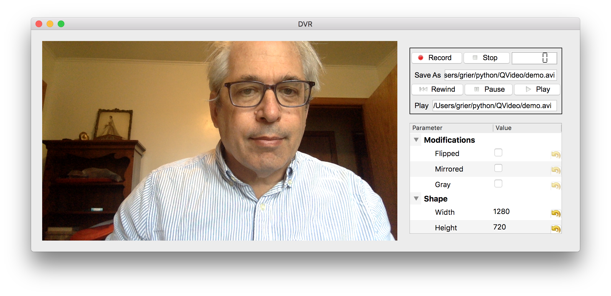

# QVideo: Qt framework for video cameras

[](https://pypi.org/project/QVideo/)
[](https://pypi.org/project/QVideo/)
[](LICENSE.md)
[](https://github.com/davidgrier/QVideo/actions/workflows/test.yml)
[](https://qvideo.readthedocs.io/en/latest/)
[](https://doi.org/10.5281/zenodo.19239402)

**QVideo** is a framework for integrating video cameras into Qt projects
(PyQt6 or PyQt5; PySide6 is experimental) for scientific research.  It provides a unified, registration-based property
system so that every camera backend is controlled through the same API.  Property
trees, display widgets, and a digital video recorder are built on top of that
abstraction and require no camera-specific code. Components plug together quickly
and easily to create robust GUI-enabled machine-vision applications that ``just work''
out of the box. QVideo provides hassle-free support for high frame rates and extended
bit depths, including pixel-accurate video recording with lossless compression.
Optional jupyter integration facilitates rapid prototyping. Web-enabled display and control 
supports remote interaction and collaboration.




## Features

- **Unified camera API** — `QCamera` subclasses expose adjustable parameters
  via `registerProperty` / `registerMethod`; UI and recording layers consume
  them without knowing the underlying hardware.
- **Auto-built property trees** — `QCameraTree` reads the registered property
  map and builds a `pyqtgraph` parameter tree widget automatically.
- **Threaded video source** — `QVideoSource` wraps any camera in a `QThread`
  and emits `newFrame(ndarray, FrameInfo)` at acquisition rate.
- **Composable filter pipeline** — `VideoFilter` objects run in a
  `QFilterPipeline` on a worker thread between source and consumers (display,
  recorder).  A `QFilterRack` lets the user add, reorder and adjust 23
  filters (smoothing, edges, thresholds, background estimates, calibration
  and more) while the program runs, and exports the pipeline as a Python
  function.
- **Graphical overlays** — `QTrackpyWidget` for live particle tracking and
  `QYoloWidget` for real-time object detection render markers directly on
  `QVideoScreen`; composite mode lets the DVR record the annotated scene.
- **Digital video recorder** — lossless HDF5 (with timestamps) and OpenCV
  video formats; `QRecorder` and `QPlayer` work without a window, and
  `QDVRWidget` is their control panel.
- **Live display** — `QVideoScreen` supports mouse-aware graphical overlays
  for annotations, regions of interest, and user interaction.

## Installation

```bash
pip install "QVideo[pyqt6]"
```

### Qt binding

QVideo needs a Qt binding: PyQt6 (recommended) or PyQt5.  The binding is
an optional extra so that QVideo can use one you already have, such as the
system packages on a Raspberry Pi, instead of installing a second copy:

```bash
pip install "QVideo[pyqt6]"   # PyQt6 (recommended)
pip install "QVideo[pyqt5]"   # PyQt5
pip install QVideo            # use a binding that is already installed
```

PySide6 is experimental (`pip install "QVideo[pyside6]"`): interactions with
core pyqtgraph features appear to cause intermittent crashes.

### Raspberry Pi

PyPI has no prebuilt ARM wheels for PyQt5 or PyQt6, so the system-provided
packages must be used instead.  Create the virtual environment with
`--system-site-packages` so pip can see them:

```bash
sudo apt install python3-pyqt6 python3-pyqt6.qtsvg
python3 -m venv --system-site-packages .venv
source .venv/bin/activate
pip install QVideo
```

Replace `python3-pyqt6` with `python3-pyqt5` if you prefer PyQt5.

### Optional hardware backends

| Backend | Extra | Notes |
|---------|-------|-------|
| GenICam cameras | `pip install QVideo[genicam]` | Installs viva-genicam (preferred, `-g`: no vendor SDK or `.cti` file, and it does not hold the interpreter lock) where it has wheels, and harvesters for vendor producers (Vimba, etc.), which need a `.cti` file and hold the interpreter lock, so QVideo opens them in a process of their own on macOS and Linux (see the compatibility page) |
| GenICam cameras, viva-genicam only | `pip install QVideo[viva]` | The preferred interface alone, without harvesters |
| Raspberry Pi camera | `pip install QVideo[picamera]` | Requires `picamera2` |
| Camera names for USB cameras | `pip install QVideo[opencv]` | Uses `cv2-enumerate-cameras`; without it the cameras are listed as "Camera 0" and so on |
| Video in a web browser or on a tablet | `pip install QVideo[stream]` | Uses `aiohttp` and `segno`: a tablet scans a QR code to watch, and with the operator's permission can change exposure, gain and the like; see the streaming page of the documentation |
| HDF5 recording (compressed without loss) | `pip install QVideo[dvr]` | Requires `h5py` and `hdf5plugin` |
| Faster lossless AVI/MKV, 16-bit gray | `pip install QVideo[av]` | Uses PyAV instead of OpenCV when installed |

## Quick start

```python
from QVideo.cameras.Noise import QNoiseCamera
from QVideo.lib import QVideoScreen, QVideoSource
import pyqtgraph as pg   # after QVideo: QVideo selects the Qt binding

pg.mkQApp()

source = QVideoSource(QNoiseCamera())   # synthetic noise: no hardware
screen = QVideoScreen()
source.newFrame.connect(screen.setImage)

screen.show()
source.start()
pg.exec()
```

Replace `QNoiseCamera` with `QOpenCVCamera`, `QFlirCamera`, etc. to switch
hardware — the rest of the code is identical.

## In a Jupyter notebook

QVideo needs no window in a notebook.  Install it into the notebook's own
environment with the `%pip` magic, restart the kernel, and ask for a camera:

```python
%pip install "QVideo[pyqt6,jupyter]"
```

```python
from QVideo import Camera, Filter

camera = await Camera()                        # opens the camera it finds
camera.filters = Filter('Smoothing', 'Canny')  # optional; Filter() lists them
camera.live_view()                             # live video in the cell
frame = camera.read()                          # a (filtered) NumPy array
```

`camera.controls()` shows the camera's settings as widgets.  See the
[Jupyter chapter](https://qvideo.readthedocs.io/en/latest/jupyter.html) for
details, including what to do if widgets show up as text.

## Camera backends

| Backend | Class | Hardware |
|---------|-------|----------|
| `cameras/Noise` | `QNoiseCamera` | Synthetic — no hardware required |
| `cameras/OpenCV` | `QOpenCVCamera` | USB webcams via OpenCV |
| `cameras/Genicam` | `QGenicamCamera` | Abstract base for all GenICam/GigE Vision cameras |
| `cameras/Flir` | `QFlirCamera` | FLIR cameras via GenICam (Spinnaker GenTL producer) |
| `cameras/Basler` | `QBaslerCamera` | Basler cameras via GenICam (pylon GenTL producer) |
| `cameras/IDS` | `QIDSCamera` | IDS Imaging cameras via GenICam |
| `cameras/MV` | `QMVCamera` | Any GenICam camera via MATRIX VISION mvGenTLProducer |
| `cameras/Vimbax` | `QVimbaXCamera` | Allied Vision cameras via VimbaX GenTL producer |
| `cameras/Viva` | `QVivaCamera` | Any GenICam camera via viva-genicam (preferred; no producer) |
| `cameras/Picamera` | `QPicamera` | Raspberry Pi camera module |

## Compatibility

Verified on real hardware (the unit tests mock all hardware):

| Backend | macOS | Ubuntu | Raspberry Pi OS | Windows |
|---------|-------|--------|-----------------|---------|
| OpenCV | 14 – 26 | 24.04 | tested | not tested |
| FLIR (GenICam) | 14 – 26 | 24.04 | — | not tested |
| Viva (GenICam, `-g`) | 26 | 24.04 | — | not tested |
| Raspberry Pi camera | — | — | tested (Pi 5) | — |

On macOS 26.7.1 (Tahoe), the OpenCV backend was tested with OpenCV
5.0.0_11 and the FLIR backend with Spinnaker SDK 4.4.0.246.  Other combinations are expected to work but have not been
checked.  See the [documentation](https://qvideo.readthedocs.io) for
details.

QVideo itself is pure Python and is tested on Python 3.11 – 3.14.  The
newest Python release may lag: Python 3.15 is run in CI as an
allowed-failure job because some dependencies (e.g. scipy) do not yet
publish wheels for it.

## Writing a new camera backend

Subclass `QCamera` and implement three methods:

```python
from QVideo.lib import QCamera

class MyCamera(QCamera):

    def _initialize(self) -> bool:
        self.device = open_my_hardware()
        if not self.device:
            return False
        self.registerProperty('exposure',
                              getter=lambda: self.device.get_exposure(),
                              setter=lambda v: self.device.set_exposure(v),
                              ptype=float)
        return True

    def _deinitialize(self) -> None:
        self.device.close()

    def read(self):
        ok, frame = self.device.read_frame()
        return ok, frame
```

`QCameraTree` and `QVideoSource` work with `MyCamera` immediately — no
additional code needed.

## Filters

Each filter is a `VideoFilter` with a widget (`Q...`) that holds its
controls.  A `QFilterRack` offers them through its *Add filter…* button,
`QFilterRack.addByName('Sobel')` adds one in code, and `Filter('Sobel')`
builds one without a window.

| Category | Filters |
|----------|---------|
| Preprocessing | Color Channel, Dejitter, Difference of Gaussians, Exposure, Gamma Correction, Invert, Region of Interest, Smoothing, Unsharp Mask |
| Edge detection | Canny, Laplacian, Sobel |
| Segmentation | Threshold, Blob |
| Background | Foreground, Running Mean, Running Median, Sample and Hold |
| Calibration | Dark Frame, Flat Field |
| Feature detection | Circle Transform |
| Artistic | Cartoon, Pencil Sketch |

## Overlays

Overlays render analysis results directly on the live `QVideoScreen`.  Each
needs its own optional packages: `pip install QVideo[trackpy]` for the trackpy
overlay, `pip install QVideo[yolo]` for the YOLO overlay (which pulls in
PyTorch), or `pip install QVideo[overlays]` for both.

| Overlay | Class | Description |
|---------|-------|-------------|
| Particle tracking | `QTrackpyWidget` | Live particle detection and tracking using `trackpy` |
| Object detection | `QYoloWidget` | Real-time bounding-box detection using YOLO (`ultralytics`) |

## Acknowledgements

Work on this project at New York University is supported by the National
Science Foundation of the United States under award number DMR-2428983 and
by an award from the TAC Program of New York University.
